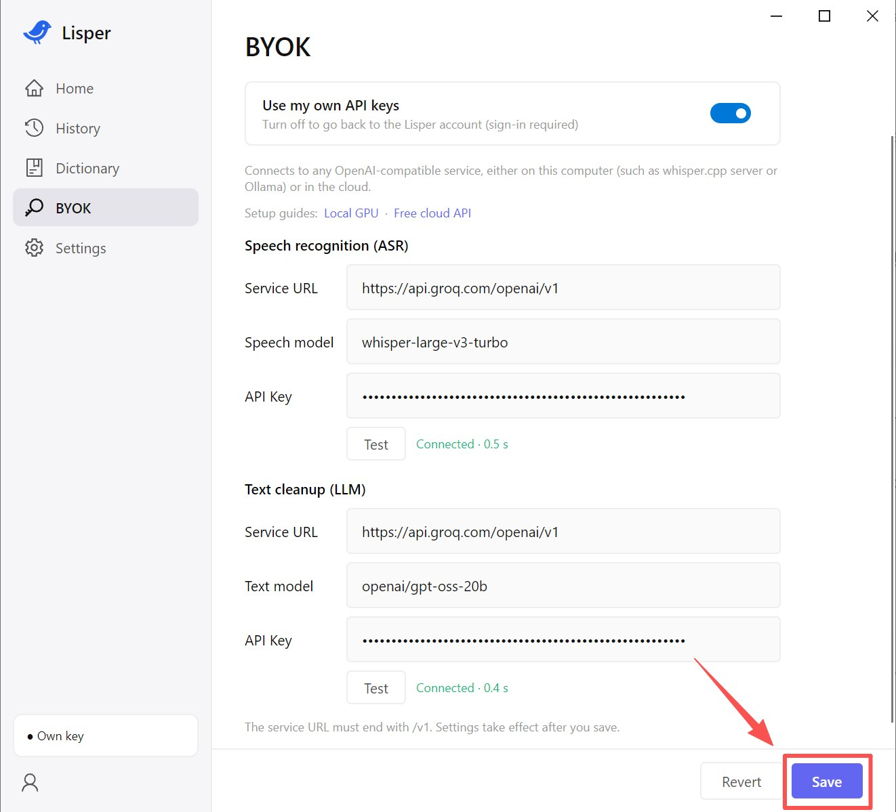
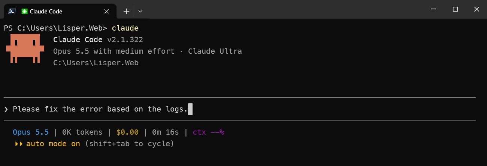

# Lisper: Free Voice Typing for Windows with Your Own API Key

[English](README.md) | [简体中文](README.zh-CN.md)

Lisper is a voice typing app for Windows. Press `Right Alt`, speak, press it again, and clean text is typed into the app where your cursor is: Claude Code, Cursor, VS Code, a terminal, a browser or a chat window.

With **BYOK** (bring your own key), Lisper is free. You connect it to a speech recognition service and a text model of your choice, such as the Groq free tier or whisper.cpp and Ollama running on your own GPU. Your voice and text go straight to the services you configure and never pass through Lisper's servers.

[Download for Windows](https://lisper.me/download?utm_source=github&utm_medium=readme) · [Website](https://lisper.me/?utm_source=github&utm_medium=readme) · [Setup guides](#setup-guides) · [Report an issue](https://github.com/lisperme/voice-typing/issues)

## Choose how you run it

| Option | Cost | Where your audio goes | Best for |
|---|---|---|---|
| **Groq free tier (BYOK)** | Free within Groq's free tier | Groq's API, using your own key | Any PC, no GPU required |
| **whisper.cpp + Ollama (BYOK)** | Free | Stays on your PC, fully offline | NVIDIA GPU with 8GB VRAM or more |
| **Lisper cloud** | Free to start, paid plans available | Lisper's servers | Works out of the box after sign-in |

Any OpenAI-compatible endpoint works with BYOK, in the cloud or on your own machine. See [pricing](https://lisper.me/pricing?utm_source=github&utm_medium=readme) for Lisper cloud plans.

## Get started in three steps

1. [Download Lisper](https://lisper.me/download?utm_source=github&utm_medium=readme) and install it.
2. Open the **BYOK** page, turn on **Use my own API keys**, and enter a service URL, model name and API key for speech recognition and text cleanup. Click **Save**, then **Test**.
3. Put your cursor in any text box, press `Right Alt`, speak, and press `Right Alt` again.

## Setup guides

- [Free cloud voice typing with the Groq Whisper API](docs/byok-groq-free-voice-typing.md): no GPU needed, about 5 minutes.
- [Offline voice typing with whisper.cpp and Ollama](docs/byok-offline-whisper-cpp-ollama.md): runs entirely on your own GPU.

## Features

- **Works in every app**: text is typed wherever your cursor is, including coding tools such as Claude Code and Cursor.
- **True to your words**: filler words such as "um" and "uh" are removed, punctuation is added, and your own wording is kept.
- **100+ languages**: mix languages freely in one sentence.
- **Personal dictionary**: teach Lisper the names, product terms and code identifiers you use.
- **History**: every result is saved on your PC so you can copy it again.
- **One hotkey**: `Right Alt` to start, `Right Alt` to stop.

## System requirements

- Windows 10 or 11, 64-bit
- A microphone
- macOS and Linux: coming soon

## FAQ

### Is Lisper free?

Yes. BYOK mode is free. You pay only what your chosen provider charges, and the Groq free tier and local models cost nothing. Lisper cloud is also free to start.

### Does my audio pass through Lisper's servers in BYOK mode?

No. In BYOK mode, Lisper sends audio and text directly to the service URLs you enter. Your API keys are stored in Lisper's config file on your PC.

### Can I use it completely offline?

Yes. Run whisper.cpp for speech recognition and Ollama for text cleanup on your own GPU. Follow the [offline guide](docs/byok-offline-whisper-cpp-ollama.md).

### Which services work with BYOK?

Any service with an OpenAI-compatible API: Groq, OpenAI, a local whisper.cpp server, Ollama and others. The service URL must end with `/v1`.

### Is the source code available?

No. Lisper is free to download, and the app is proprietary. This repository hosts documentation, setup guides and the issue tracker.

## Feedback

- Bugs and feature requests: [open an issue](https://github.com/lisperme/voice-typing/issues/new/choose)
- Help center: [lisper.me/help](https://lisper.me/help?utm_source=github&utm_medium=readme)
- Contact: [lisper.me/contact](https://lisper.me/contact?utm_source=github&utm_medium=readme)

---

Free to download. Proprietary software © 2026 Lisper.
