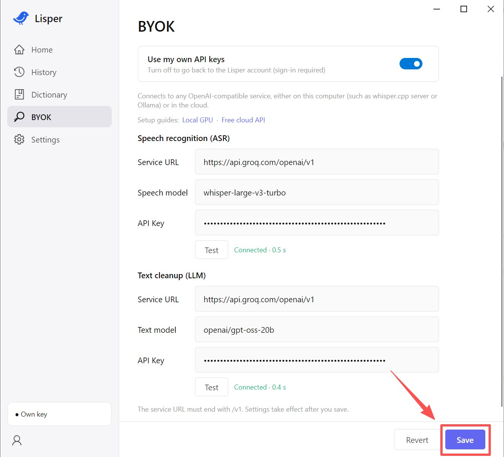
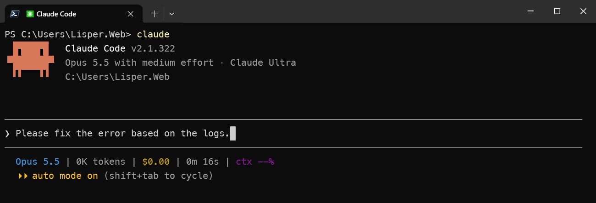

# Lisper：自带 API Key 的免费 Windows 语音输入

[English](README.md) | [简体中文](README.zh-CN.md)

Lisper 是一款 Windows 语音输入工具。按一下 `Right Alt` 开始说话，再按一下结束，整理好的文字即输入到光标所在的应用：Claude Code、Cursor、VS Code、终端、浏览器或聊天窗口。

使用 **BYOK**（自带 API Key）模式时，Lisper 免费。语音识别服务与文本模型由你选择，例如 Groq 免费额度，或在自己显卡上运行的 whisper.cpp 与 Ollama。语音和文字直接发送到你配置的服务，不经过 Lisper 服务器。

[下载 Windows 版](https://lisper.me/zh/download?utm_source=github&utm_medium=readme) · [官网](https://lisper.me/zh?utm_source=github&utm_medium=readme) · [配置教程](#配置教程) · [反馈问题](https://github.com/lisperme/voice-typing/issues)

## 三种使用方式

| 方式 | 费用 | 音频去向 | 适合 |
|---|---|---|---|
| **Groq 免费额度（BYOK）** | Groq 免费额度内不收费 | Groq API，使用你自己的 key | 任何电脑，无需独立显卡 |
| **whisper.cpp + Ollama（BYOK）** | 免费 | 留在本机，完全离线 | 8GB 及以上显存的 NVIDIA 显卡 |
| **Lisper 云端** | 免费起步，另有付费方案 | Lisper 服务器 | 登录即用，无需配置 |

BYOK 支持任何兼容 OpenAI 接口的服务，云端或本机均可。Lisper 云端方案见[定价页](https://lisper.me/zh/pricing?utm_source=github&utm_medium=readme)。

## 三步开始

1. [下载 Lisper](https://lisper.me/zh/download?utm_source=github&utm_medium=readme) 并安装。
2. 打开 **BYOK** 页，开启「Use my own API keys」，为语音识别与文本整理分别填写服务地址、模型名与 API Key。点 **Save** 保存，再点 **Test** 测试连接。
3. 把光标放进任意输入框，按 `Right Alt` 说话，说完再按一次 `Right Alt`。

## 配置教程

- [用 Groq Whisper API 免费语音输入](docs/byok-groq-free-voice-typing.md)：无需显卡，约 5 分钟完成。
- [用 whisper.cpp 与 Ollama 离线语音输入](docs/byok-offline-whisper-cpp-ollama.md)：完全在本机显卡上运行。

教程为英文，界面文字与截图一致。

## 功能

- **任意应用可用**：文字输入到光标所在位置，包括 Claude Code、Cursor 等编程工具。
- **保留原话**：去掉「呃」「嗯」等语气词，补全标点，保留你的措辞。
- **支持 100 多种语言**：同一句话可混用多种语言。
- **个人字典**：添加常用的人名、产品名与代码标识符。
- **历史记录**：每条结果保存在本机，可随时再次复制。
- **一个热键**：`Right Alt` 开始，`Right Alt` 结束。

## 系统要求

- Windows 10 或 11，64 位
- 麦克风
- macOS 与 Linux 版即将推出

## 常见问题

### Lisper 免费吗？

免费。BYOK 模式不收费，只需支付所选服务商的费用；Groq 免费额度与本地模型均不产生费用。Lisper 云端同样可以免费起步。

### BYOK 模式下音频会经过 Lisper 服务器吗？

不会。BYOK 模式下，Lisper 把音频和文字直接发送到你填写的服务地址。API Key 保存在本机的 Lisper 配置文件中。

### 可以完全离线使用吗？

可以。在本机显卡上运行 whisper.cpp 做语音识别、Ollama 做文本整理，步骤见[离线教程](docs/byok-offline-whisper-cpp-ollama.md)。

### BYOK 支持哪些服务？

任何兼容 OpenAI 接口的服务：Groq、OpenAI、本地 whisper.cpp 服务、Ollama 等。服务地址须以 `/v1` 结尾。

### 源代码公开吗？

不公开。Lisper 可免费下载，应用为专有软件。本仓库提供文档、配置教程与问题反馈。

## 反馈

- 问题与功能建议：[提交 issue](https://github.com/lisperme/voice-typing/issues/new/choose)
- 帮助中心：[lisper.me/help](https://lisper.me/zh/help?utm_source=github&utm_medium=readme)
- 联系我们：[lisper.me/contact](https://lisper.me/zh/contact?utm_source=github&utm_medium=readme)

---

免费下载。专有软件 © 2026 Lisper。
