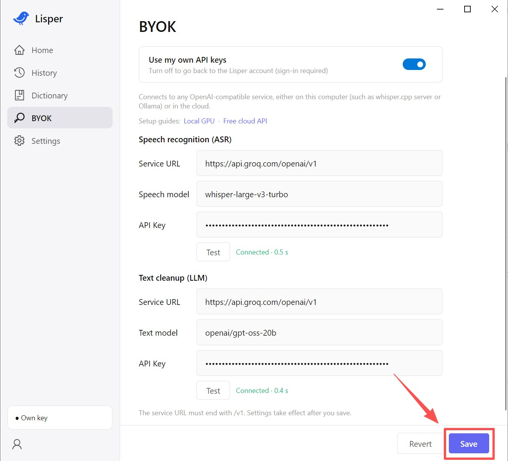

# Free Voice Typing on Windows with the Groq Whisper API

Groq's free tier gives you an OpenAI-compatible Whisper API at no cost. Connect it to Lisper's BYOK mode and you get free voice typing on any Windows PC, with no dedicated GPU. One Groq API key covers both speech recognition and text cleanup, and setup takes three steps.

> Full guide with every screenshot and the Groq free tier limits: [Groq Whisper API for Free Voice Typing on Windows](https://lisper.me/blog/groq-whisper-api-voice-typing?utm_source=github&utm_medium=docs)

Before you start, [download Lisper](https://lisper.me/download?utm_source=github&utm_medium=docs) and install it.

## Step 1: Create a Groq API key

1. Sign up and log in at [console.groq.com](https://console.groq.com).
2. Open [API Keys](https://console.groq.com/keys) and click **Create API Key**.
3. Enter a display name, set **Expiration** to **No expiration**, and click **Submit**.
4. Click **Copy**. Groq shows the full key only once, so store it somewhere safe.

## Step 2: Enter the Groq settings in Lisper

1. Open Lisper and click **BYOK** on the left.
2. Turn on **Use my own API keys**.
3. Fill in both sections, replacing `<your-groq-api-key>` with your key:

```text
Speech recognition (ASR)
  Service URL:   https://api.groq.com/openai/v1
  Speech model:  whisper-large-v3-turbo
  API Key:       <your-groq-api-key>

Text cleanup (LLM)
  Service URL:   https://api.groq.com/openai/v1
  Text model:    openai/gpt-oss-20b
  API Key:       <your-groq-api-key>
```

4. Click **Save**, then click **Test** under each section. **Connected** with a response time means the connection works.

The service URL ends at `/v1`, with nothing after it.

<p align="center"></p>

Optional: under **Settings > Primary language**, choose the language you speak. Groq then skips automatic language detection.

## Step 3: Test it in Notepad

Open Notepad, press `Right Alt`, speak a sentence, and press `Right Alt` again. The cleaned-up text appears at the cursor. Every other app works the same way: editors, terminals, chat windows and browsers.

## FAQ

### Is the Groq API free?

Yes. Groq has a free tier with per-model request and usage limits. For everyday personal dictation it is usually enough. Check the Limits page in the Groq console for the current values.

### Where is my API key stored?

In Lisper's config file on your PC. Lisper sends it only to the service URL you entered, and it never passes through Lisper's servers.

### What if I need it fully offline?

Run speech recognition and text cleanup on your own GPU. See [Offline voice typing with whisper.cpp and Ollama](byok-offline-whisper-cpp-ollama.md).

---

[Back to Lisper](../README.md) · [Full guide on lisper.me](https://lisper.me/blog/groq-whisper-api-voice-typing?utm_source=github&utm_medium=docs)
