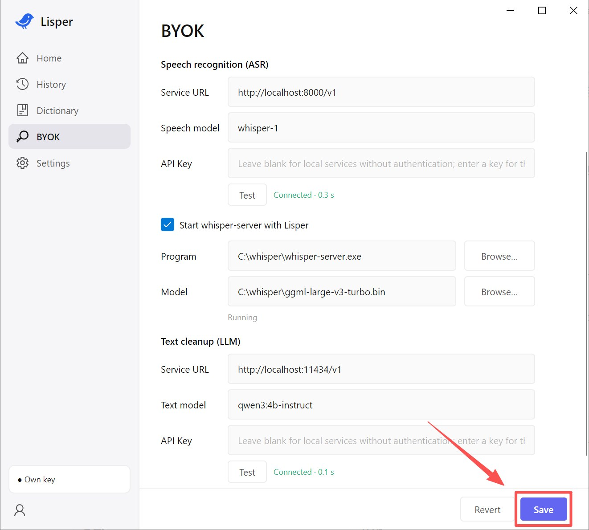

# Offline Voice Typing on Windows with whisper.cpp and Ollama

Run speech recognition with whisper.cpp and text cleanup with Ollama on your own NVIDIA GPU, then connect both to Lisper's BYOK mode. The result is free, offline voice typing: your audio never leaves your PC. On an 8GB RTX 5060, recognition plus cleanup takes about 2 seconds per sentence.

> Full guide with every screenshot, timing and troubleshooting: [whisper.cpp Windows: Offline Voice Typing with Ollama](https://lisper.me/blog/whisper-cpp-windows-voice-typing?utm_source=github&utm_medium=docs)

## Requirements

- An NVIDIA GPU with 8GB of VRAM or more. Run `nvidia-smi` in PowerShell to check your card and memory.
- [Lisper](https://lisper.me/download?utm_source=github&utm_medium=docs) installed.

## Step 1: Set up whisper.cpp

1. From the [whisper.cpp releases](https://github.com/ggml-org/whisper.cpp/releases), download the Windows CUDA build: a zip with `win-cuda` and `x64` in its name.
2. Download the model [ggml-large-v3-turbo.bin](https://huggingface.co/ggerganov/whisper.cpp/resolve/main/ggml-large-v3-turbo.bin) (about 1.5GB).
3. Unzip the build to `C:\whisper` and put the model file in the same folder.
4. Optional test: start the server and send it a sample file.

```powershell
cd C:\whisper
.\whisper-server.exe -m ggml-large-v3-turbo.bin -l auto --host 127.0.0.1 --port 8000 --inference-path /v1/audio/transcriptions
```

```powershell
curl.exe -L -o jfk.wav https://github.com/ggml-org/whisper.cpp/raw/master/samples/jfk.wav
curl.exe http://127.0.0.1:8000/v1/audio/transcriptions -F file=@jfk.wav -F response_format=json
```

If `whisper-server.exe` exits without output and `$LASTEXITCODE` shows `-1073741515`, install the [Microsoft Visual C++ runtime](https://aka.ms/vs/17/release/vc_redist.x64.exe). After the test, press `Ctrl+C` to stop the server; Lisper starts it from now on.

## Step 2: Set up Ollama

1. Install Ollama from [ollama.com/download](https://ollama.com/download).
2. Pull the text cleanup model:

```powershell
ollama pull qwen3:4b-instruct
```

3. Set the context length and keep the model loaded, then restart Ollama from the system tray:

```powershell
setx OLLAMA_CONTEXT_LENGTH 8192
setx OLLAMA_KEEP_ALIVE 1h
```

Use `8192` on an 8GB card and `16384` with 12GB or more. Run `ollama ps` after a request: `PROCESSOR` should show `100% GPU`.

## Step 3: Connect both services in Lisper

1. Open Lisper, click **BYOK**, and turn on **Use my own API keys**.
2. Check **Start whisper-server with Lisper**, then browse to `C:\whisper\whisper-server.exe` and the model file.
3. Click **Save**. When the status changes to **Running**, click **Test** under each section.

```text
Speech recognition (ASR)
  Service URL:   http://localhost:8000/v1
  Speech model:  whisper-1
  API Key:       (leave blank)

  [x] Start whisper-server with Lisper
  Program:       C:\whisper\whisper-server.exe
  Model:         C:\whisper\ggml-large-v3-turbo.bin

Text cleanup (LLM)
  Service URL:   http://localhost:11434/v1
  Text model:    qwen3:4b-instruct
  API Key:       (leave blank)
```

<p align="center"></p>

Lisper starts whisper-server in the background each time it opens, preloads both models, and stops the server when you exit.

## Step 4: Dictate

Put your cursor in Notepad, Claude Code or any other text box, press `Right Alt`, speak, and press `Right Alt` again. The cleaned-up text appears at the cursor.

## Troubleshooting

| Message or symptom | What to check |
|---|---|
| **Cannot connect** | The service is not running, or the address or port is wrong. |
| **Wrong address or model name** | The service URL must end with `/v1`; check the model name. |
| **A service is already running on this port** | A whisper-server you started by hand is still running. Close that window, then click **Start**. |
| Port 8000 is used by another program | Change the ASR service URL to another port, such as `http://localhost:8001/v1`, and click **Save**. Lisper restarts whisper-server on that port. |
| The first sentence is slow after a break | Set `OLLAMA_KEEP_ALIVE` as in step 2 and restart Ollama. |

To free VRAM for a game, run `ollama stop qwen3:4b-instruct`. Ollama loads the model again when it is next needed.

---

[Back to Lisper](../README.md) · [Full guide on lisper.me](https://lisper.me/blog/whisper-cpp-windows-voice-typing?utm_source=github&utm_medium=docs)
